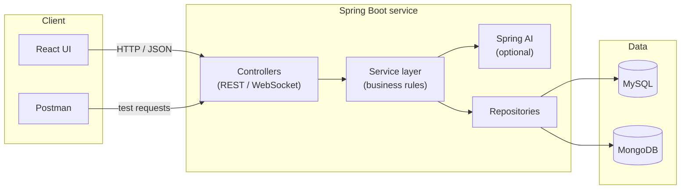
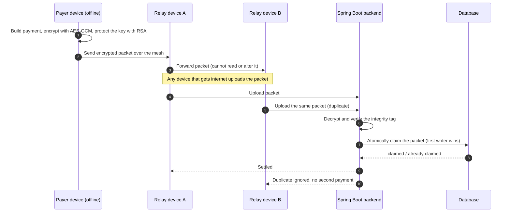
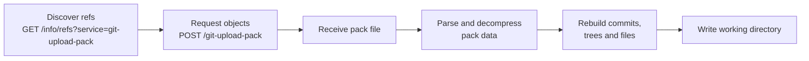

<!--
  SETUP
  1. Repo name must be exactly: itsprateek4510/itsprateek4510 (public)
  2. Keep this file as README.md in the repo root
  3. Put banner.svg and footer.svg in an "assets" folder next to it
  4. Replace UPI_REPO_URL and GITCLONE_REPO_URL below with your real repo links
  No third-party image services are used, so nothing here can break.
-->

<p align="center">
  
</p>

<p align="center">
  <a href="https://linkedin.com/in/itsprateek4510"><b>LinkedIn</b></a> &nbsp;|&nbsp;
  <a href="mailto:prateekkushwaha868@gmail.com"><b>Email</b></a> &nbsp;|&nbsp;
  <a href="https://github.com/itsprateek4510?tab=repositories"><b>Repositories</b></a>
</p>

<br/>

## `$ whoami`

I'm **Prateek Kushwaha**, a software developer from Delhi, India, currently doing my **B.Tech in Computer Science and Engineering** at Galgotias College of Engineering & Technology.

My focus is **backend engineering**. I like designing REST APIs, shaping database schemas, and making systems behave correctly when things go wrong: duplicate requests, dropped connections, hostile networks. I learn best by building the thing myself, which is why one of my current projects is a Git client written from scratch.

```json
{
  "name": "Prateek Kushwaha",
  "role": "Software Developer (backend-focused)",
  "location": "Delhi, India",
  "education": "B.Tech CSE, Galgotias College of Engineering & Technology (2024-2028)",
  "languages_spoken": ["English", "Hindi"],
  "certifications": ["Java Programming Certificate"],
  "core_strengths": [
    "Object-Oriented Programming",
    "Data Structures & Algorithms",
    "REST API design",
    "Database schema design",
    "Microservices with Spring Boot",
    "System design fundamentals"
  ],
  "working_style": ["System thinking", "Team collaboration", "Problem solving", "Compliance & data privacy"],
  "currently_building": ["UPI Offline Mesh Payment System", "Git client from scratch"],
  "status": "learning, building, shipping"
}
```

<br/>

## `$ cat skills.yml`

```yaml
backend:
  language: Java
  framework: Spring Boot
  ai_integration: Spring AI
  api_style: REST
  realtime: WebSocket
  architecture: [microservices, layered services, system design fundamentals]

databases:
  relational: MySQL
  document: MongoDB

frontend: [React, JavaScript, HTML, CSS]

other_languages: [Python, JavaScript]

ai_and_ml: [Spring AI, Python, ML fundamentals]

tooling: [Git, Docker, Postman, CI/CD]

practices: [OOP, DSA, Agile sprints, unit testing, code review, documentation]
```

### How a typical service of mine is layered



The idea behind this layout: controllers only translate HTTP into method calls, services own the business rules, and repositories own persistence. That separation keeps each layer easy to test on its own, and it lets me swap a database or add an AI step without rewriting everything above it.

<br/>

## `$ ls projects/`

### UPI Offline Mesh Payment System

> **Sep 2025 to present** &nbsp;|&nbsp; Java, Spring Boot &nbsp;|&nbsp; [Repository](UPI_REPO_URL)

**The problem.** UPI needs the internet. In a basement, a crowded event, or an area with weak coverage, a payment simply fails. 

**The idea.** Let the payment travel through a **peer-to-peer mesh of nearby devices** until one of them reaches the internet and hands it to the backend. The Spring Boot backend then settles it.

**The hard parts** are the ones that make this a backend problem rather than a networking toy:

1. **Strangers carry the payment.** Relay devices must not be able to read or modify it.
2. **Many devices may upload the same payment.** It must still be settled exactly once.



**Key design decisions**

| Problem | Approach | Why it matters |
| :-- | :-- | :-- |
| Relays can read the payment | **Hybrid encryption: RSA + AES-GCM** | AES-GCM is fast and encrypts the payload. RSA protects the AES key so only the backend can unlock it. |
| Relays can modify the payment | **GCM authentication tag** | Any change to the packet fails verification, so tampering is detected instead of silently accepted. |
| Same packet uploaded by several devices | **Atomic deduplication** | Checking "already processed?" and claiming the packet happen as one indivisible step. A separate read-then-write would let two requests both pass the check and pay twice. |
| Uploads race each other | **Exactly-once settlement** | Exactly one request wins the claim. The rest get a harmless "already handled" response. |

**Failure modes a system like this has to survive**
- Two relays upload the same packet at the same millisecond (the race the atomic claim exists for)
- A packet is delayed in the mesh and arrives much later than expected
- A packet is modified in transit
- A client retries after a timeout and sends the packet again
- A relay device is malicious and tries to replay old packets

**What this project teaches:** idempotency, concurrency control, applied cryptography, and designing for unreliable networks instead of assuming a perfect one.

<br/>

### Git Clone in Python

> **Aug 2025 to present** &nbsp;|&nbsp; Python, no Git libraries &nbsp;|&nbsp; [Repository](GITCLONE_REPO_URL)

**The goal.** Reimplement the core of `git clone` from scratch, without using any Git library, to understand exactly what Git does on the wire and on disk.

**What it does.** It connects to a remote repository over the **Git HTTP protocol**, fetches the refs, downloads the **pack file**, then parses and decompresses it to rebuild the full commit history, file trees, and the working directory.



**Concepts this project covers**
- Git's object model: **commits point to trees, trees point to blobs**, and everything is addressed by hash
- How the client and server negotiate which objects are needed
- Why pack files exist: objects are stored **compressed**, packed together to save bandwidth and disk space
- Parsing a binary format byte by byte instead of trusting a library

**Why I built it.** Using Git every day is easy. Rebuilding its core is the fastest way to stop treating it as magic. The same habit of understanding the layer below applies to databases, HTTP, and encryption.

<br/>

## `$ git log --graph --oneline`

```text
* 2025-09  feat: UPI Offline Mesh Payment System (Spring Boot, RSA + AES-GCM, exactly-once settlement)
* 2025-08  feat: Git client from scratch in Python (HTTP protocol, pack files, full history rebuild)
* 2025-01  join: Project Engineer (academic role)
|           - led backend on 3+ team projects
|           - designed REST APIs and database schemas, wrote unit tests
|           - ran Agile sprints, Git workflows, code reviews, documentation
* 2024-09  init: B.Tech CSE, Galgotias College of Engineering & Technology
* 2023-08  lead: Head Boy, Modern School, Noida (until Jan 2024)
|           - led student council, coordinated students and administration, mentored peers
```

<br/>

## `$ cat principles.md`

How I think about backend work:

1. **Design for the failure, not the demo.** Networks drop, clients retry, devices lie. If a design only works when everything goes right, it doesn't work.
2. **Make operations idempotent.** Running the same request twice should never mean charging twice.
3. **Trust nothing in transit.** Encrypt it, authenticate it, verify it.
4. **Understand the layer below.** Rebuilding Git taught me more than a year of using it.
5. **Ship APIs with tests.** An endpoint, its schema, and its unit tests are one deliverable.
6. **Write for the next reader.** Clear naming, code reviews, and documentation are part of the job.
7. **Keep concerns separate.** Controllers, services, repositories: each layer does one thing.

<br/>

## `$ cat roadmap.md`

```markdown
- [x] REST API design with Spring Boot
- [x] Relational and document databases (MySQL, MongoDB)
- [x] Applied cryptography (hybrid RSA + AES-GCM)
- [x] Concurrency-safe, exactly-once processing
- [ ] Authentication and authorization with Spring Security (JWT, OAuth2)
- [ ] Caching with Redis
- [ ] Message queues (Kafka or RabbitMQ)
- [ ] Database indexing and query tuning
- [ ] Observability: structured logs, metrics, tracing
- [ ] Distributed systems fundamentals
```

<br/>

## `$ ping prateek`

```text
64 bytes from prateek: status=open, reply_time=fast
```

I'm always happy to talk about backend design, system design, and interesting side projects.

- **LinkedIn:** [linkedin.com/in/itsprateek4510](https://linkedin.com/in/itsprateek4510)
- **Email:** [prateekkushwaha868@gmail.com](mailto:prateekkushwaha868@gmail.com)

<br/>

<p align="center">
  
</p>
