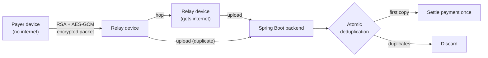

<div align="center">


<a href="https://git.io/typing-svg">
  
</a>

<br/>

<a href="https://linkedin.com/in/itsprateek4510"></a>
<a href="mailto:prateekkushwaha868@gmail.com"></a>


</div>

<br/>

## 👋 About me

I'm a software developer from Delhi, studying **B.Tech in Computer Science** at Galgotias College of Engineering & Technology. I like backend work: designing REST APIs, shaping database schemas, and understanding how things work all the way down.

- 🔭 Building a **UPI payment system that works without internet** and a **Git client from scratch**
- ⚙️ Strong on OOP, DSA, microservices, and system design fundamentals
- 🤖 Exploring AI-integrated apps with **Spring AI** and ML
- 🤝 Led the backend on 3+ team projects with Agile sprints, code reviews, and unit tests

<br/>

## 🚧 Featured projects

| Project | What it does | Built with |
| :-- | :-- | :-- |
| **[UPI Offline Mesh Payment System](UPI_REPO_URL)** | Routes UPI payments through a peer-to-peer mesh network when the internet is down. Each transaction is encrypted with hybrid RSA + AES-GCM so relay devices can't read or tamper with it. Every payment settles exactly once, even when several devices upload the same packet at the same time. | Java, Spring Boot |
| **[Git Clone in Python](GITCLONE_REPO_URL)** | A Git client built from scratch with no Git libraries. It talks to remote repos over the Git HTTP protocol, fetches refs, downloads pack files, and parses them to rebuild the commit history, file trees, and working directory. | Python |

### How the offline payment flow works



<br/>

## 🧰 Tech stack

**Backend**


**Frontend**


**Databases**


**Tools & Practices**


<br/>

## 📊 GitHub stats

<div align="center">


</div>

<br/>

## 🧠 How I work

```java
public class Prateek {
    String focus       = "backend systems & system design";
    String curiosity   = "how things work under the hood";
    String[] building  = {"UPI offline mesh payments", "Git, from scratch"};
    boolean testsFirst = true; // APIs, schemas, and unit tests ship together
}
```

<br/>

<div align="center">


</div>
