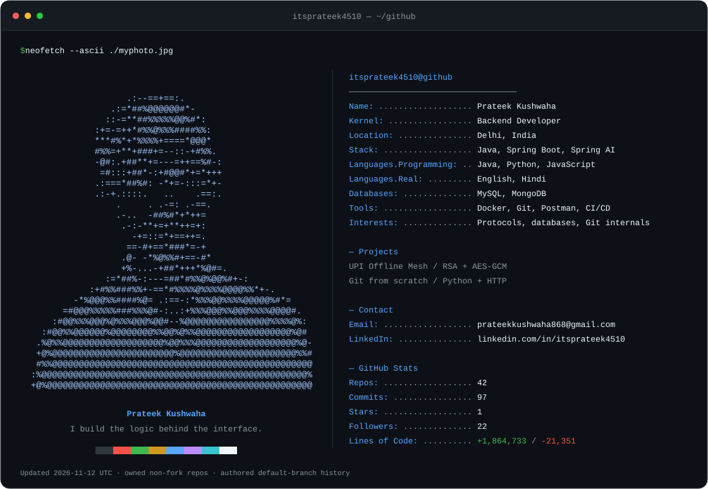

<picture>
  <source media="(prefers-color-scheme: dark)" srcset="assets/dark.svg" />
  <source media="(prefers-color-scheme: light)" srcset="assets/light.svg" />
  
</picture>

  <a href="https://www.linkedin.com/in/itsprateek4510/">LinkedIn ↗</a>
  &nbsp; / &nbsp;
  <a href="mailto:prateekkushwaha868@gmail.com">Email ↗</a>
  &nbsp; / &nbsp;
  <a href="https://github.com/itsprateek4510?tab=repositories">Repositories ↗</a>

<a href="SETUP.md">How this profile is generated</a>

