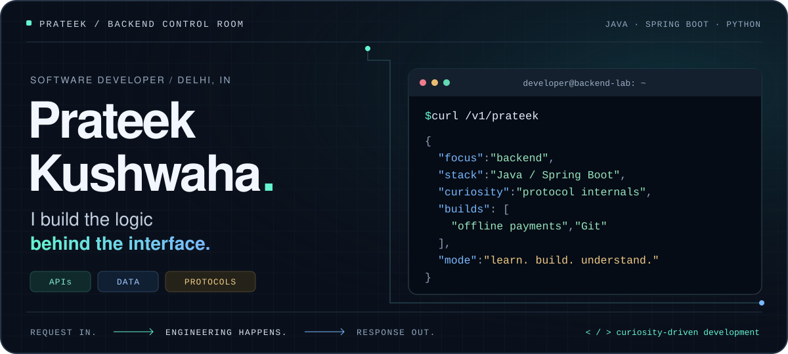
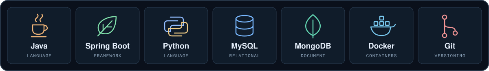
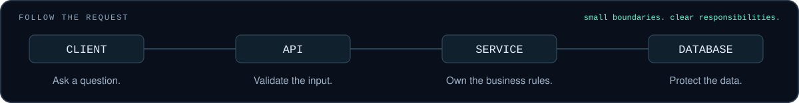
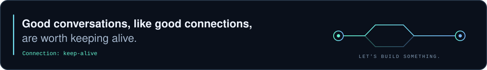

  

  <a href="https://www.linkedin.com/in/itsprateek4510/"><strong>LinkedIn ↗</strong></a>
  &nbsp;&nbsp; / &nbsp;&nbsp;
  <a href="mailto:prateekkushwaha868@gmail.com"><strong>Email ↗</strong></a>
  &nbsp;&nbsp; / &nbsp;&nbsp;
  <a href="https://github.com/itsprateek4510?tab=repositories"><strong>Explore repositories ↗</strong></a>

  I build backends with <strong>Java &amp; Spring Boot</strong> and follow my curiosity into protocols, 
  databases, and the things that happen when a request doesn't go to plan.

<h2><code>01</code> The toolchain</h2>

  

  ALSO IN THE TOOLBOX 
  <code>Spring AI</code> &nbsp; <code>React</code> &nbsp; <code>WebSocket</code> &nbsp; <code>Postman</code> &nbsp; <code>CI/CD</code>

<h2><code>02</code> Built to understand</h2>

<table>
  <tr>
    <td width="50%" valign="top">
      
<code>01 / DISTRIBUTED PAYMENTS</code>

      <h3>When the network disappears.</h3>
      
<strong>UPI Offline Mesh Payment System</strong>

      
A Spring Boot backend that routes payment packets through nearby peers when the originating device is offline.

      <ul>
        <li><strong>RSA + AES-GCM</strong> keeps relays from reading or tampering with transactions.</li>
        <li><strong>Atomic deduplication</strong> prevents concurrent uploads from settling a payment twice.</li>
      </ul>
      
<code>Java</code> <code>Spring Boot</code> <code>Cryptography</code>

    </td>
    <td width="50%" valign="top">
      
<code>02 / DEVELOPER TOOLS</code>

      <h3>One command. A whole protocol.</h3>
      
<strong>Git Clone — From Scratch</strong>

      
A Python implementation of Git's core clone behaviour, built without Git libraries to understand the machinery underneath.

      <ul>
        <li><strong>Speaks Git over HTTP</strong> to discover refs and download pack files.</li>
        <li><strong>Parses binary pack data</strong> to rebuild commit history, file trees, and a working directory.</li>
      </ul>
      
<code>Python</code> <code>HTTP</code> <code>Git internals</code>

    </td>
  </tr>
</table>

  

<h2><code>03</code> Behind the endpoints</h2>

<table>
  <tr>
    <td width="50%" valign="top">
      <h3>Building with a team</h3>
      
<strong>Project Engineer · Academic role</strong> January 2025 — present

      
Led backend development on <strong>3+ team projects</strong>: REST APIs, database schemas, unit tests, and code reviews.

    </td>
    <td width="50%" valign="top">
      <h3>Learning the foundations</h3>
      
<strong>B.Tech · Computer Science &amp; Engineering</strong> 2024 — 2028

      
Galgotias College of Engineering &amp; Technology. Based in <strong>Delhi, India</strong>.

    </td>
  </tr>
</table>

  <em>My favourite way to understand a black box? Build what's inside it.</em>

  

